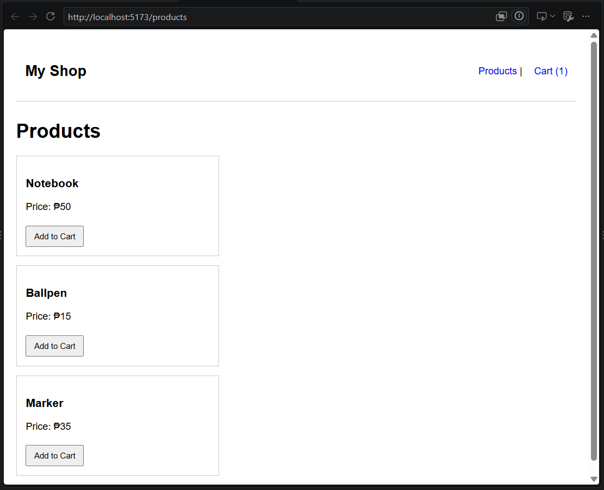
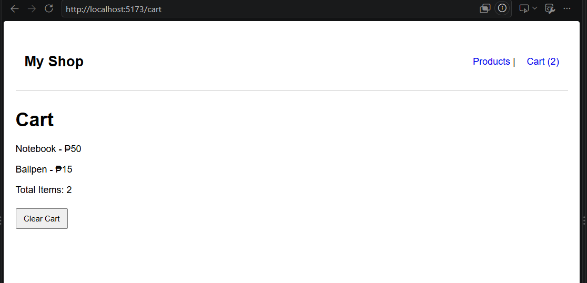

# Week 7 Mini Activity - Shared Cart and Page Navigation

## Description

This project is a simple React shopping cart application with a Products page and a Cart page. It demonstrates page navigation using React Router and shared cart state using React Context.

## Features

- Products page at `/products`
- Cart page at `/cart`
- Three sample products
- Add to Cart button
- Shared cart state using React Context
- Cart count in the navigation bar
- Clear Cart button
- Navigation between Products and Cart pages

## Technologies Used

- React
- Vite
- React Router
- React Context
- JavaScript
- CSS

## Setup Instructions

1. Clone or download this repository.
2. Open the project folder in VS Code.
3. Open the terminal.
4. Install the project dependencies: npm install
5. Run this: npm run dev
6. Open the local URL shown in the terminal.

## Explanation

The cart state is stored in CartContext.jsx using React Context. The Products page uses the shared addToCart function, while the Cart page uses the shared cart state and clearCart function. The navigation bar also accesses the same cart state to display the current cart count.

## Screenshots

### Products Page

### Cart Page

